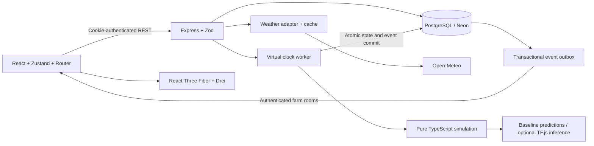

# Architecture proposal

> Historical proposal from the initial project design. It describes an earlier tomato-only scope and is not the current implementation. See README.md, MODELING.md and API.md for current behavior.

## Scope and system boundaries

AgriTwin is a software-only digital twin for configurable tomato farms. React renders backend simulation values; it does not independently evolve soil water, growth, stress, or yield. Each simulation is reproducible from its initial state, model version, daily weather inputs, and ordered management events.

The first release targets one persistent Node.js backend process. Horizontal scaling requires a distributed job lease and Socket.IO adapter; an in-memory timer alone cannot coordinate multiple instances.

## Modules and data flow



The frontend contains landing/auth pages and a protected application shell, farm management, twin view, analytics, irrigation, insights, experiments, and settings. Reusable shadcn/ui components, Tailwind styles, Recharts, and Lucide icons provide consistent controls. Zustand stores selected farm/plot, UI preferences, connection status, and server snapshots. Server responses remain authoritative.

The backend contains auth, farm/plot management, crop configurations, weather retrieval, simulations, irrigation, predictions, analytics, scenarios, sockets, and background jobs. Shared TypeScript contracts and Zod schemas define API boundaries. The simulation package has no Express, Prisma, timer, or rendering dependencies.

## Repository layout

```text
digital_twin/
  apps/web/src/{components,pages,farm3d,hooks,stores,services}
  apps/api/src/{modules,routes,services,simulation,ml,sockets,jobs}
  apps/api/prisma/{schema.prisma,migrations,seed.ts}
  packages/shared/{types,schemas}
  datasets/
  docs/
  .env.example
  README.md
```

Use npm workspaces. Resolve compatible stable dependency versions during implementation, record Node requirements, and commit the lockfile. Do not choose unverified versions in this design document.

## Relational model

| Entity | Core fields and relationships |
| --- | --- |
| User | UUID, unique normalized email, password hash, created/updated timestamps; owns farms |
| Farm | ownerId, name, latitude, longitude, canonical area in m², display unit, timezone; owns plots and runs |
| Plot | farmId, name, areaM2, soil configuration, irrigation method, layout coordinates; owns plantings |
| Crop | unique crop key and parameter version, parameter JSON, units and provenance |
| Planting | plotId, cropId, planting date; records crop configuration used at planting |
| SimulationRun | farmId, parentRunId, initial snapshot reference, virtual date, status, speed, version, model version, seed, configuration |
| WeatherRecord | runId, date, source kind, provider, retrieval time, normalized weather and raw-input hash |
| SimulationSnapshot | runId, date, sequence/version, model version; owns immutable plot states |
| PlotState | snapshotId, plotId, plantingId, soilWaterMm, GDD, age, stress accumulation, biomass/growth proxy, yield estimate, cumulative water |
| IrrigationEvent | runId, plotId, scheduled/applied virtual date, requested/effective water mm, efficiency, status, idempotency key |
| Prediction | runId, snapshotId, plotId, kind, method/model version, input hash, output JSON, creation time |
| Scenario | farmId, baselineRunId, branchRunId, startingSnapshotId, parameter changes and experiment horizon |
| OutboxEvent | runId, sequence, event type, payload, delivery state; bridges commits and broadcasts |

Use UUID primary keys, foreign keys, timestamps, and indexes on ownership, run/date, and plot/event date. Enforce unique snapshot (runId, sequence), unique plot state (snapshotId, plotId), and unique event idempotency keys within their run. Add SQL check constraints for coordinates, positive areas, and valid nonnegative water quantities where Prisma cannot express them.

A farm must not have overlapping active runs for the same intended live view. Experiments are separate runs. Snapshot creation copies crop/soil parameters so editing a farm cannot rewrite history. Plot edits affecting active runs require a new run or an explicit reset. Deleting a farm cascades its dependent records in a transaction after stopping its worker.

## Deterministic simulation

One model step represents one virtual day. Use date-only ISO values and UTC date arithmetic to avoid daylight-saving drift. The worker speed affects how frequently daily steps execute, never the physical equations. Events have a stable ordering. Model versions and explicit numeric rounding policy are stored with runs.

### Root-zone water balance

All depths are mm of water per plot. Root-zone depth Zr is in metres; volumetric soil coefficients are fractions. Capacity in mm is `theta * Zr * 1000`. Initially use a fixed documented root-zone depth so changing root depth does not introduce untracked water.

For each day:

1. Apply due irrigation events once: effective irrigation = gross depth × method efficiency. Track gross withdrawals and application losses separately.
2. Partition rainfall into infiltration and runoff using a documented configurable infiltration limit; record each term.
3. Limit infiltration plus initial storage to saturation, recording overflow runoff.
4. Compute reference evapotranspiration from supplied ET0 when available. Any fallback must be a documented approximation with an explicit quality flag.
5. Potential crop ET = ET0 × stage crop coefficient. Actual ET is limited by available water and a water-stress coefficient.
6. Drain water above field capacity using a bounded drainage coefficient.
7. Store ending water and all balance terms. Water cannot be removed below zero or exceed saturation.

Conservation invariant: initial storage + rain + gross irrigation = final storage + runoff + application losses + actual ET + drainage. Clamping must not silently create or discard water. Conversion: 1 mm over 1 m² is 1 litre.

### Crop growth and stress

Accumulate nonnegative GDD from daily mean temperature above a crop base temperature, with an explicit upper-temperature treatment. Crop configuration supplies ordered stage thresholds for germination, vegetation, flowering, fruit development, maturity, and harvest. Distinguish thermal stage progression from a water-limited growth/biomass proxy. Record cumulative stress and high-temperature penalties; harvest stops further yield accumulation.

Yield begins as a transparent potential-yield scaling model using area, growth progress, and accumulated stress. Display it as a simulation estimate. Do not show statistical prediction intervals without calibration data. Numerical tomato/soil parameters require primary-source review during implementation; demonstration defaults must be labeled assumptions rather than universal agronomic constants.

Immediate irrigation updates storage, water totals, and an immutable event snapshot without advancing date or reapplying daily ET. Recommendations can update immediately; accumulated crop damage does not disappear immediately after watering.

### Clock, persistence, and replay

Support start, pause, resume, speed, step, bounded multi-day advance, reset, snapshot, and replay. A per-run lock plus optimistic database version prevents simultaneous HTTP/job mutations. Every daily transaction stores weather input, plot states, executed events, predictions, clock version, and outbox messages. Broadcast only committed states.

On restart, read running jobs from the database and resume from their last committed day. Reset creates a fresh run preserving historical runs. Replay retrieves immutable snapshots. Full deterministic recomputation uses the saved input stream and exact model version.

## Weather

Fetch Open-Meteo exclusively through a backend adapter with timeouts, bounded retries, a cache keyed by rounded coordinates/date/product, and unit validation. Store the exact normalized values consumed by each daily step.

Label each input as historical/reanalysis, forecast, or synthetic. Historical provider data is not automatically a direct observation at the farm. Beyond the forecast horizon use seeded synthetic scenarios, visibly labeled. Offline fallback is also synthetic and never silently presented as current weather. Persist frozen weather for scenario pairs so both branches use the same source sequence before requested modifiers.

## Irrigation and experiments

Schedule irrigation by virtual date with recurrence and an enabled flag. Pause/disable cancels future applications only. Events are idempotent and ownership checked. Water consumption uses gross withdrawals; soil balance uses effective inputs.

Experiments clone one exact snapshot and weather sequence into baseline and modified runs. Modifiers include irrigation interval/amount, skipped irrigation days, rain multiplier, and temperature delta. Compare aligned daily soil water, stress, growth, gross water, and yield. Show both per-plot and area-weighted farm values. Experimental writes must never mutate the source run.

## Machine learning

Ship agronomic baseline inference first with method labels. Separate TensorFlow.js training, evaluation, serialization, and inference modules. If no credible agricultural training data is available, train only an optional surrogate on documented synthetic trajectories and label its evaluation as agreement with the simulator, not real-farm accuracy.

Split by entire trajectory/farm/scenario before preprocessing. Fit normalization on training data only. Store seeds, generator/data versions, feature order, units, split manifests, metrics, and model hashes. Compare held-out regression MAE/RMSE and stress-class confusion matrices against baselines. Training runs offline; HTTP handlers load persisted models. Missing or incompatible artifacts cause an explicit baseline fallback.

## REST and socket contract

Routes under `/api/v1`:

- `POST /auth/register`, `/auth/login`, `/auth/logout`; `GET /auth/me`.
- `GET/POST /farms`; `GET/PATCH/DELETE /farms/:farmId`.
- `GET/POST /farms/:farmId/plots`; `PATCH/DELETE /farms/:farmId/plots/:plotId`.
- `GET /crops`; `GET /farms/:farmId/weather`.
- `POST /farms/:farmId/runs`; `GET /runs/:runId/state`.
- `POST /runs/:runId/control` with validated action and bounded arguments.
- `GET /runs/:runId/snapshots`; `GET /runs/:runId/snapshots/:snapshotId`.
- `GET/POST /runs/:runId/irrigation`; `PATCH /runs/:runId/irrigation/:eventId`.
- `GET /runs/:runId/predictions`, `/runs/:runId/analytics`.
- `POST /runs/:runId/scenarios`; `GET /scenarios/:scenarioId/comparison`.
- `GET /health`, `/ready`, `/openapi.json`, `/docs`.

Document payloads, units, errors, pagination, and idempotency in OpenAPI during implementation. Bound farm sizes, plot counts, simulation horizons, and request rates.

Authenticate sockets from signed cookies and verify ownership before joining `farm:<id>`. Emit typed events with runId, virtual date, monotonically increasing version, and payload. Clients reject stale versions and fetch authoritative state after reconnect or gaps. Apply authorization to nested resources, not just the farm list.

## Security and deployment

Hash passwords using a maintained password-hashing library. JWT cookies use HttpOnly, Secure in production, explicit expiry, and an appropriate SameSite policy. Validate Origin and CSRF tokens for state-changing requests. Use exact credentialed CORS origins, login/register rate limits, validated environment configuration, and redacted structured logs.

Vercel frontend and Render backend on unrelated domains can encounter third-party cookie restrictions. Prefer custom sibling domains under one parent domain; explicitly verify cross-origin cookie and WebSocket behavior. Neon credentials remain server-side. Use a suitable runtime connection URL and migration connection URL. Apply migrations as a release task. Render requires persistent WebSocket service support; model artifacts must survive redeploy through image packaging or durable storage.

## Risks and assumptions

The simulation is educational and requires field validation before agronomic use. Soil hydraulic defaults, tomato cultivar thresholds, irrigation efficiency, and potential yield vary by location. Daily resolution cannot resolve subdaily runoff or stress. Weather gaps, external outages, free hosting restarts, concurrent mutations, and GPU limitations need visible recovery states. Provide reduced 3D detail and a usable numeric plot view when WebGL is unavailable.
